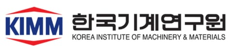
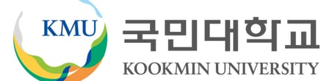
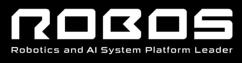
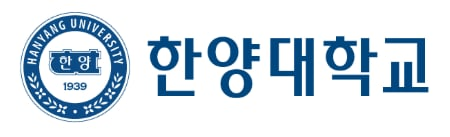

# RV LAB

RV LAB은 경기대학교 전자공학부에서 **자율주행**과 **휴머노이드** 관련 기술을 연구하는 연구실입니다.

<!--
첫 화면 소개 문구입니다.
## 협력 기관: 로고 이미지를 한 줄에 하나씩 ()
그 밖의 ## 절은 모집 안내 상자이며, 절을 지우면 상자가 사라집니다. > 줄은 작은 공지로 표시됩니다.
-->

## 학부연구생 / 대학원생 환영

위 연구에 관심이 있어 학부연구생·대학원 진학을 원하는 학생은 구글 설문지를 작성한 뒤 지도교수에게 메일 바랍니다.

> ('26.03.15) 현재 학부연구생이 많아, 대학원(타교/자교) 진학을 생각하는 학생만 지도 가능합니다.

## 협력 기관

