# 연구 과제

지도교수가 참여·수행한 산학·국책 연구 과제입니다.

<!--
과제 하나 = ## 번호. 제목 하나.
  제목 아래 첫 줄: 지원 기관 · 기간 (· Project Lead)
  그 다음 사진만 있는 줄은 대표 이미지, 나머지는 자유롭게 작성 (본문 사진 가능)
  YouTube 주소만 있는 줄은 영상 썸네일로 표시됩니다. 여러 줄을 붙여 쓰면 나란히 배치됩니다.
  [제목](YouTube 주소) 형식으로 쓰면 영상 아래에 제목이 붙습니다.
-->

## 9. Development of Outdoor SLAM with 3D LiDAR/IMU/RTK-GPS

Electronics and Telecommunications Research Institute · 05.2024 – 12.2024

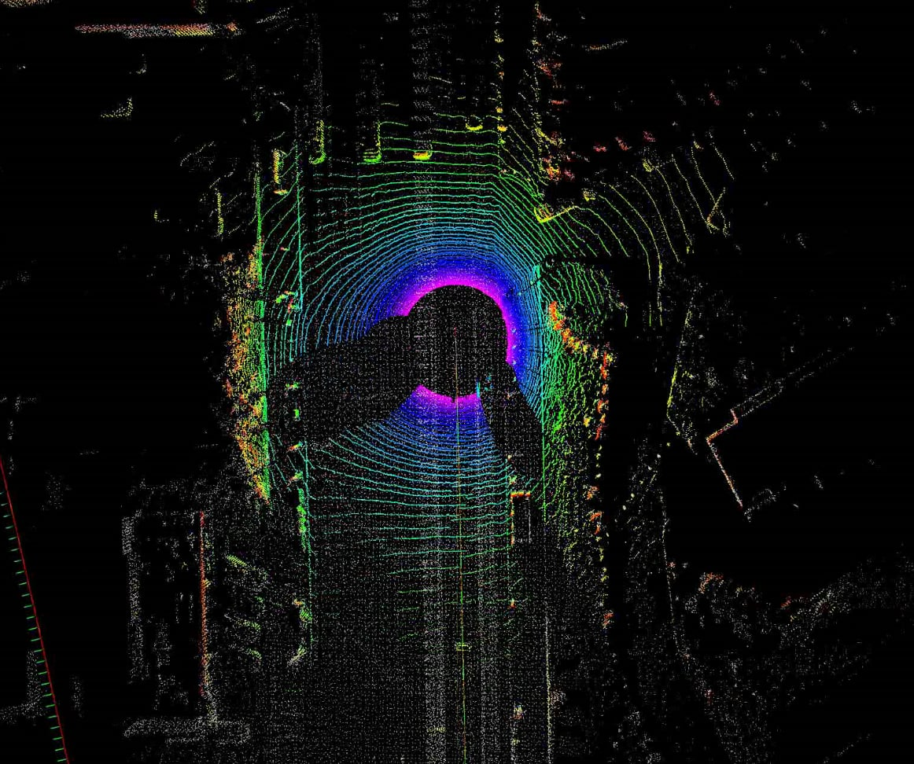

The goal of the project is to develop 3D LiDAR-IMU-GPS SLAM. Robustness is increased by precise 3D LiDAR odometry and Factor Graph Optimization with IMU and RTK-GPS in the shadow area of RTK-GPS.

### Personal Research Activities

**(a) IMU-RTK-GPS Kalman Filter**

- Implementing Quaternion based error-state Kalman Filter
- 6D pose (x, y, z, roll, pitch, yaw) localization
- Fusing with IMU + RTK-GPS in outdoor

https://youtu.be/CsQ3Uvhno78

**(b) 3D LiDAR odometry with IMU preintegration**

- Implementing 3D-LiDAR SLAM (LOAM) algorithm
- Fusing with IMU-Preintegration + 3D LiDAR Odometry

https://youtu.be/AZoUcHY0Kqc

**(c) Structure of Factor Graph Optimization (3D LiDAR + IMU + RTK-GPS)**

## 8. Development of Indoor SLAM fused with 2D LiDAR/IMU

Electronics and Telecommunications Research Institute · 05.2024 – 12.2024

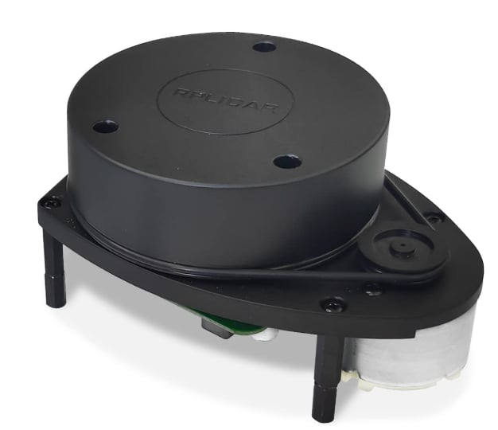

The goal of the project is to develop 2D LiDAR-IMU SLAM. Robustness is increased by precise 2D LiDAR odometry and Factor Graph Optimization with IMU in indoor.

### Personal Research Activities

**(a) 2D LiDAR SLAM + IMU Preintegration**

- Developing 2D LiDAR SLAM based on GICP matching
- Fusing with IMU-preintegration for performance

https://youtu.be/2ff4LiW2qw4

## 7. Development of Autonomous Driving Golf Cart

Daedong Co., Ltd. · 06.2022 – Present

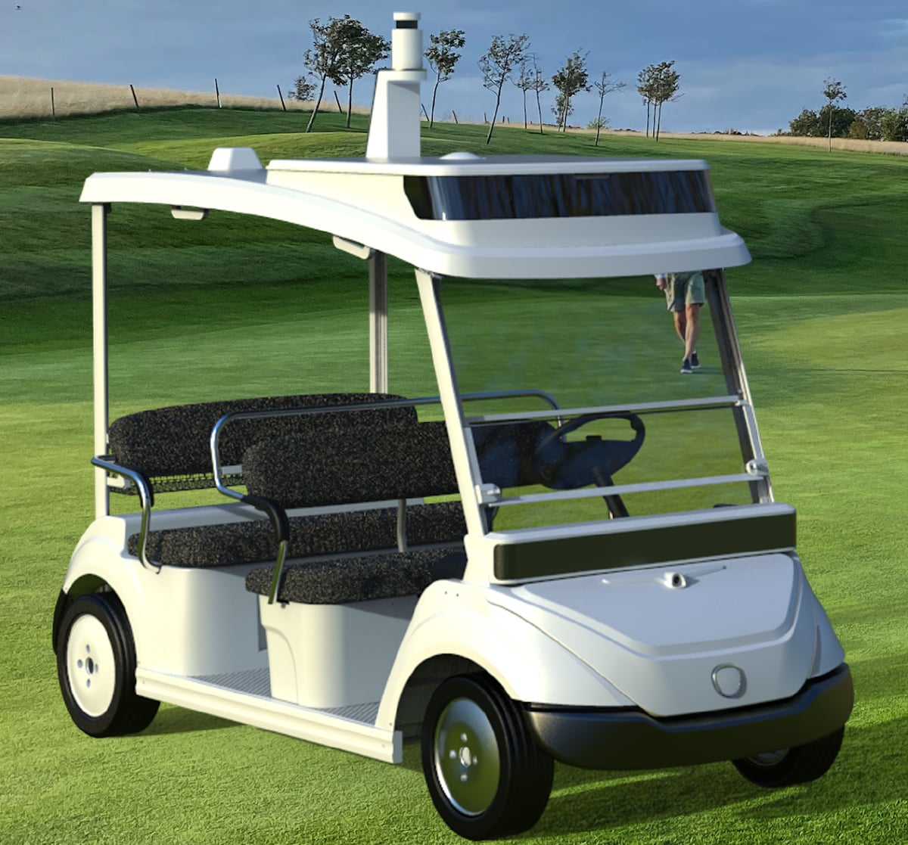

The goal of the project is to modify golf carts for autonomous driving to replace the manpower. The golf carts are equipped with stereo cameras, LiDAR, RTK-GPS, and 4D radar sensor.

### Personal Research Activities

**(a) HD map generation in test driving area**

- Creating HD map using the [LIO-SAM](https://github.com/TixiaoShan/LIO-SAM) algorithm
- Calibrating HD maps in UTM (RTK-GPS) system
- Adding road information by a [vector map builder](https://tools.tier4.jp/feature/vector_map_builder_ll2/) tool

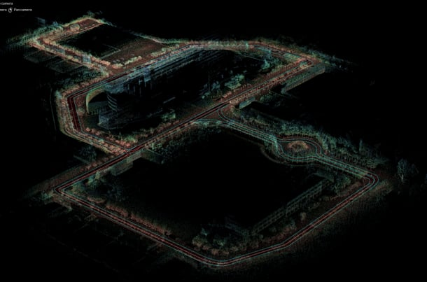

**(b) Integration of autonomous driving system**

- Implementing a [LiDAR-based tracking](https://github.com/TixiaoShan/autoware_tracker) algorithm
- Localizing the cart based on RTK-GPS and kinematics
- Integrating algorithms on Ubuntu 18.04, ROS Melodic

https://youtu.be/OeremWAyrOM

**(c) 4D Radar-Camera Vehicle Pose Estimation**

- Implementing EKF for vehicle pose estimation based on vehicles detected by [YOLO v4](https://github.com/Tossy0423/yolov4-for-darknet_ros) and 4D radar data
- Proving robustness in foggy environments compared to conventional algorithms

https://youtu.be/lHoVQ2n_4zk

### Related Paper

- Seunghoon Yang\*, Minseong Choi\*, Seungho Han, Keun Ha Choi and Kyung-Soo Kim. "4D Radar-Camera Sensor Fusion for Robust Vehicle Pose Estimation in Foggy Environments", IEEE Access, 2023 (\*: equal contribution). [paper](https://drive.google.com/file/d/1UKHTdEif6KvCJwoY-umhw_zkp65kLLDP/view)

## 6. Development of Camera-LiDAR Fusion for Desnowing

Korea Institute of Machinery and Materials · 06.2022 – 12.2023

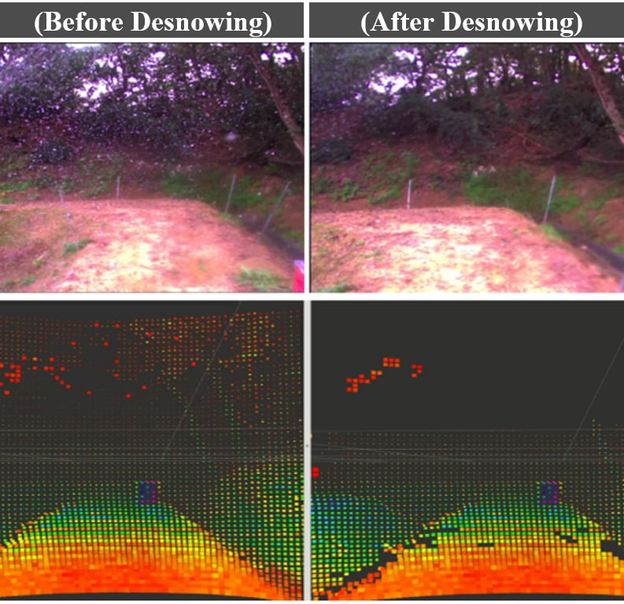

The goal of the project is to remove noise such as snow and rain from image and LiDAR data. Subsequently, develop a SLAM algorithm for off-road environments where GPS is limited by fusing data from both sensors.

### Personal Research Activities

**(a) Desnowing and deraining algorithm**

- Implementing deraining algorithm ([S2VD](https://github.com/zsyOAOA/S2VD)) and desnowing algorithm (Hampel-based) in Ubuntu 18.04, Anaconda environment with PyTorch
- Using [TensorRT](https://developer.nvidia.com/tensorrt) for real-time implementation
- Especially, Low-Intensity Outlier Removal (LIOR) is proposed for LiDAR desnowing algorithm

https://youtu.be/2tMymn1YUaI

**(b) LiDAR-camera calibration**

- Proposing a LiDAR-camera calibration method that is applicable both high and low resolution LiDAR.
- Using tilted calibration board, perform following steps: (a) Estimate the plane model, (b) Project plate points on the estimated plane, (c) Find subsets for line optimization, (d) Optimize the edge lines of the plate & vertex

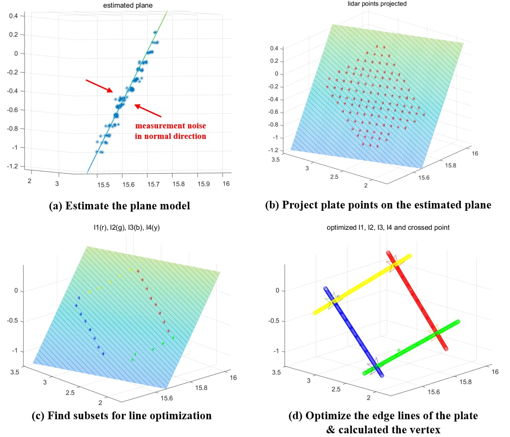

**(c) Desnowed LiDAR-camera fused SLAM**

- Integrating desnowing algorithm (Hampel-based), LiDAR desnowing algorithm (LIOR) into [A-LOAM](https://github.com/HKUST-Aerial-Robotics/A-LOAM)
- Evaluating performance of proposed SLAM compared to RTK-GPS as pseudo-ground truth

https://youtu.be/ghUfv3r2VCs

### Related Paper & Patents

- Minseong Choi, Seunghoon Yang, Seungho Han, Minyoung Lee, Keun Ha Choi and Kyung-Soo Kim. "MSC-RAD4R: ROS-Based Automotive Dataset With 4D Radar", IEEE Robotics and Automation Letters, 2023. [paper](https://drive.google.com/file/d/1xDMapeXWkxFSfY63wUV0FMOuYrpjglGh/view)
- US-17486923 : Method and Apparatus for Removing LiDAR Point Cloud Noise
- KR-10-2021-0071925 : LiDAR Point Cloud Noise Removal Method and Device

## 5. Development of Visual Inspection Quadruped Robot

Korea Hydro and Nuclear Power · 03.2022 – 12.2022

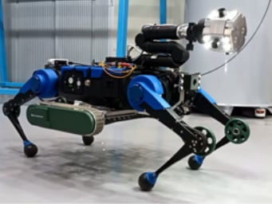

The visual inspection of seawater pipelines used for discharging waste heat from power plants is essential. The goal of the project is to develop a quadruped walking robot for inspecting underwater pipelines.

### Personal Research Activities

**(a) Localization in seawater pipelines**

- Developing a localization algorithm using GICP by matching [VINS-Fusion](https://github.com/HKUST-Aerial-Robotics/VINS-Fusion) map with 3D CAD pipe model.
- Displaying the number of current pipe (red) through the closest point from the estimated pose

https://youtu.be/uyFEGttU4qQ

### Related Paper

- Hyun-Bin Kim, Chanseok Kim, Byeong-Il Ham, Jeonguk Kang, Minseong Choi, Keun Ha Choi and Kyung-Soo Kim. "Development of Dual-Mode Locomotion Quadruped Robot for Pipe Inspection." International Conference on Intelligent Robots and Systems (IROS). IEEE, 2024 (under review). [paper](https://drive.google.com/file/d/1iRAUYhY1-TnOY8_HBXTMQz6-YyJX3dZA/view)

## 4. Development of Anti-lock Braking System and Electronic Stability Control

Jeju Free International City Development Center · 06.2020 – 12.2021 · Project Lead

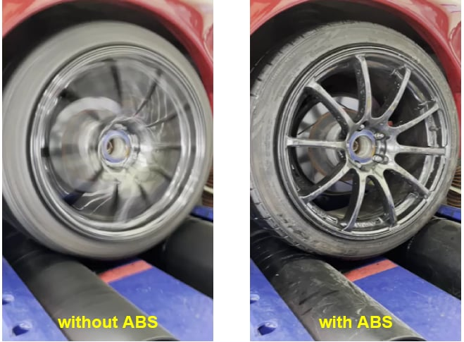

The goal of the project is to develop safety technologies ensuring vehicle stability, including the Anti-lock Braking System (ABS) and Electronic Stability Control (ESC).

### Personal Research Activities

**(a) Anti-lock Braking System (ABS) controller**

- Suggesting a robust controller under tire model uncertainties by Nonlinear Disturbance Observer via Sliding Mode Controller
- Verifying the performance of the proposed method in MATLAB/Simulink CarSim simulation

https://youtu.be/onAotHIJAks

**(b) Electronic Stability Control (ESC)**

- Estimating side slip angle by (Extended) Kalman Filter
- Conducting direct yaw tracking with sliding mode controller.
- Verifying in MATLAB/Simulink CarSim simulation

https://youtu.be/8J9KNMMrnGo

**(c) Real-world experimental validation**

- ABS hydraulic circuit analysis and reverse engineering
- Actual electric vehicle modification
- Dynamo load experiment verification

### Related Papers

- Minseong Choi, Kyunghwan Choi, Minsu Cho, Minyoung Lee and Kyung-Soo Kim. "Chattering Reduction of Sliding Mode Control via Nonlinear Disturbance Observer for Anti-lock Braking System and Verification With CarSim Simulation", International Journal of Automotive Technology (IJAT), 2023. [paper](https://drive.google.com/file/d/1yBjrb4aARN6g1T2u6dRD_FMNYboqD8rJ/view)
- 최민성, 최효서, 조민수, 김경수. (2022). Nonlinear Disturbance Observer 기반 ABS 제어기 시뮬레이션 검증 및 이를 위한 실제 차량 개조. 한국자동차공학회 춘계학술대회, 309-309. [paper](https://drive.google.com/file/d/1BCQmy_mPB5Hb2IZP5PG0R2YFI4cbIo6x/view)
- 최민성, 최효서, 이민영, 차무현, 김경수. (2021). Extended Kalman Filter 기반 Side Slip Angle 추정 및 이를 기반한 차량의 횡방향 Sliding Mode Control 설계. 한국정밀공학회 학술발표대회 논문집, 201-201. [paper](https://drive.google.com/file/d/1q9qDhC8XHG-sD8Ld5-vUW27k1ev_zaUR/view)

## 3. Development of Visual SLAM for Rover

Korea Institute of Civil Engineering and Building Technology · 03.2020 – 12.2021 · Project Lead

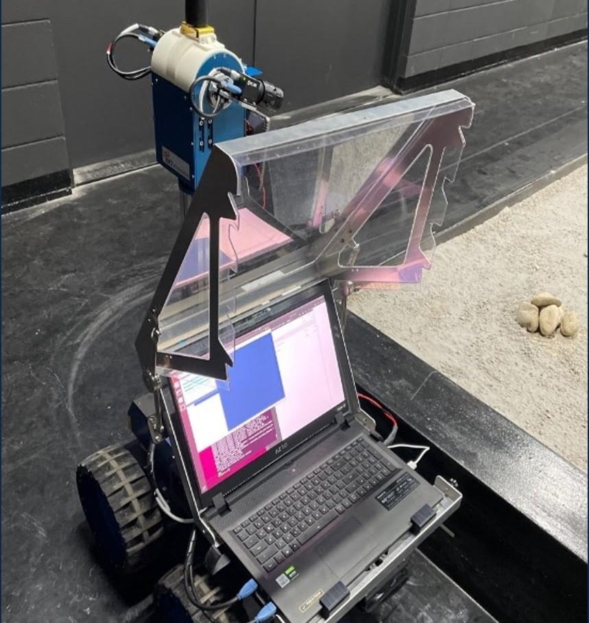

Research on 3D printing architecture on the moon has been extensively conducted recently. The goal of the project is to develop visual SLAM for planetary mapping the surrounding terrain of rover in lunar environments.

### Personal Research Activities

**(a) Low-light image enhancement**

- Implementing low-light enhancement algorithms (GLADnet, MBLLEN, Retinex net, ..) on real hardware
- Modifying FP64 -> FP16 for real-time performance

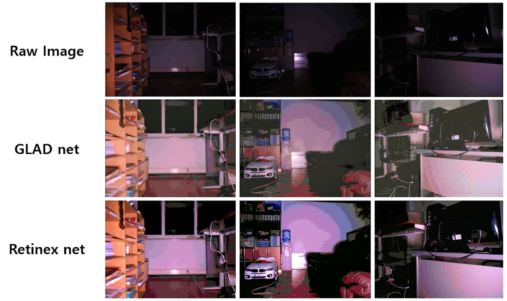

**(b) Self-supervised CNN depth estimation**

- Implementing depth estimation algorithms (BM, SGBM, ELAS, SS-CNN, ..) on real hardware

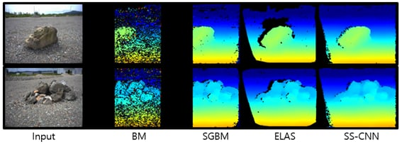

**(c) Integration algorithms with SLAM on a rover**

- Integrate low-light image enhancement and depth estimation algorithms with SLAM on a rover
- LLIE algorithm: GLADnet, depth estimation: SS-CNN, SLAM algorithm: S-PTAM
- Environment: Ubuntu 18.04, ROS Melodic

https://youtu.be/8k9GltwAl0c

### Related Paper

- Sungchul Hong, Antyanta Bangunharcana, Jae-Min Park, Minseong Choi and Hyu-Soung Shin. "Visual SLAM-Based Robotic Mapping Method for Planetary Construction", Sensors, 2021. [paper](https://drive.google.com/file/d/1GBKciHNnAXbIyaPG1TC0FFUqA70ap2jq/view)

## 2. Development of Unmanned Snow Plow for Runways

Institute of Civil-Military Technology Cooperation · 06.2019 – 12.2022

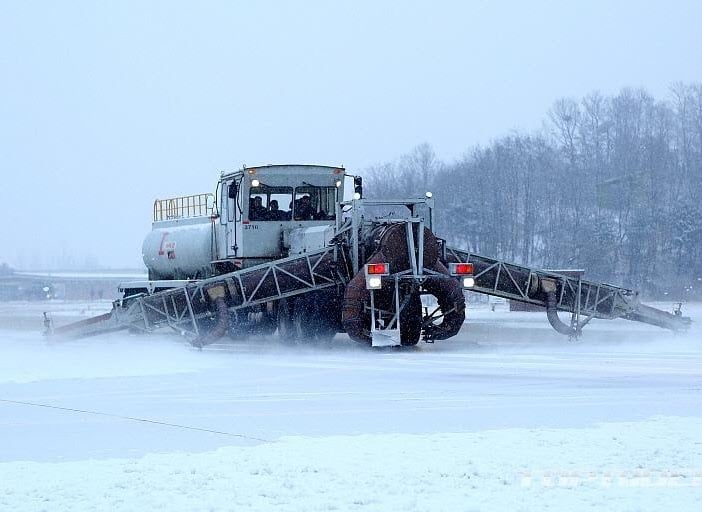

The goal of the project is to modify snow plow (SE-88) for autonomous driving.

### Personal Research Activities

**(a) Vehicle speed controller simulation**

- Proposing constant speed driving algorithm at low speeds for the runway snowplow equipment SE-88
- Verifying in MATLAB/Simulink TruckSim simulation

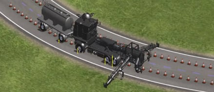

**(b) ROS-based platform for acquiring dataset**

- Developing a small unmanned platform for data collection in extreme snowfall/rain conditions and acquisition of sensor data
- VIS camera, IR camera, LiDAR, Radar, IMU, GPS

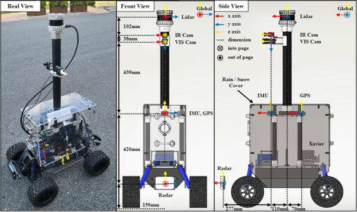

### Related Papers

- Seungho Han, Minseong Choi, et al. "Dynamic Control and Simulation of Leader-Follower Vehicle Formation Considering Vehicle Stability", International Journal of Control, Automation, and Systems (IJCAS), 2023. [paper](https://drive.google.com/file/d/1P2GtZKFsomTDs0CHHfLGng7PAHxQZFn4/view)
- Ji-Il Park\*, Minseong Choi\*, et al. "Development of ROS-based Small Unmanned Platform for Acquiring Autonomous Driving Dataset in Various Places and Weather Conditions", 2022 IEEE 46th Annual Computers, Software, and Application Conference (COMPSAC). IEEE, 2022 (\*: equal contribution). [paper](https://drive.google.com/file/d/1JHxnlgOiwAcBOk4kQ8WHc9wRXD7f6nk5/view)
- Chanho Ko, Seungho Han, Minseong Choi and Kyung-Soo Kim. "Integrated Path Planning and Tracking Control of Autonomous Vehicle for Collision Avoidance Based on Model Predictive Control and Potential Field", 2020 20th International Conference on Control, Automation and Systems (ICCAS). IEEE, 2020. [paper](https://drive.google.com/file/d/1S436huZLPWRb8pp65HOA21V1u7xoQlwt/view)
- 최효서, 최민성, 박지일, 이영석, 조민수, 한승호, ... & 김경수. (2022). 공군 활주로 제설작전 차량의 저속 주행환경 속도제어를 위한 시뮬레이션 검증. 한국정밀공학회 학술발표대회논문집, 279-279. [paper](https://drive.google.com/file/d/1MD1S3Lw0PIxFC9mS4YJNG-B-IhDb6ed2/view)
- 양승훈, 한승호, 박지일, 조민수, 최민성, 이영석, ... & 김경수. (2022). 라이다를 활용한 공군 활주로 제설작전 차량 편대제어 중 장애물 충돌 방지 시스템을 위한 검증 실험. 한국정밀공학회 학술발표대회 논문집, 217-217. [paper](https://drive.google.com/file/d/17tR9bdqQNuv2xq4qGRXdgxzBopes76eS/view)
- 송형주, 한승호, 최민성, 고찬호, 차무현, & 김경수. (2020). 공군 활주로 제설작전 차량 무인화를 위한 동역학 모델링 및 주행성능 평가를 위한 시뮬레이션 환경구축. 대한기계학회 춘추학술대회, 157-159. [paper](https://drive.google.com/file/d/1UbVrPHpuICx9eypvqQvPgxiwVDqoNVSM/view)

## 1. Development of Hybrid Electric Vehicle Conversion Kit for Diesel Delivery Trucks

Ministry of Land, Infrastructure and Transport · 06.2018 – 12.2020

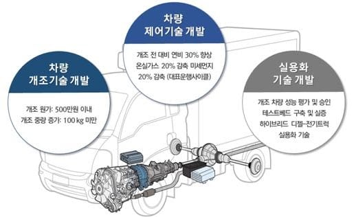

The goal of the project is to reduce fine dust emissions and improve fuel efficiency for existing diesel small trucks used for delivery vehicles by hybridizing them with the addition of a clutch, motor and battery.

### Personal Research Activities

**(a) Self-energizing clutch for hybrid vehicles**

- Designing a self-energizing clutch for engine start, with reduced power impact and improved operational performance, for mode switching in hybrid vehicles
- ABAQUS Finite Element Analysis (FEA)
- Experimental validation on the test bench

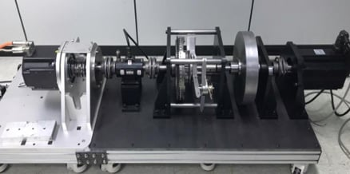

### Related Patent

- KR-10-2020-0104510 : Self-energizing Clutch Transferring Restricted Torque and Hybrid Vehicle
