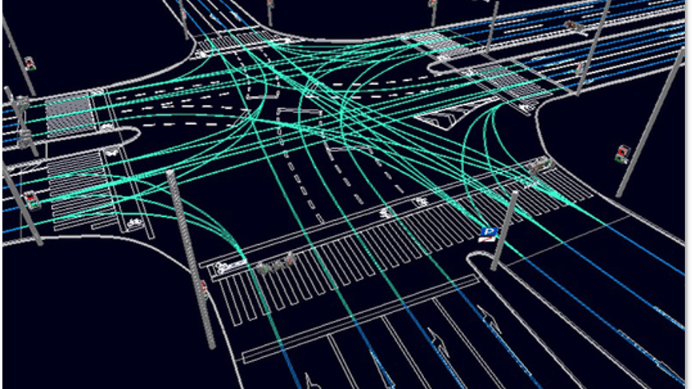
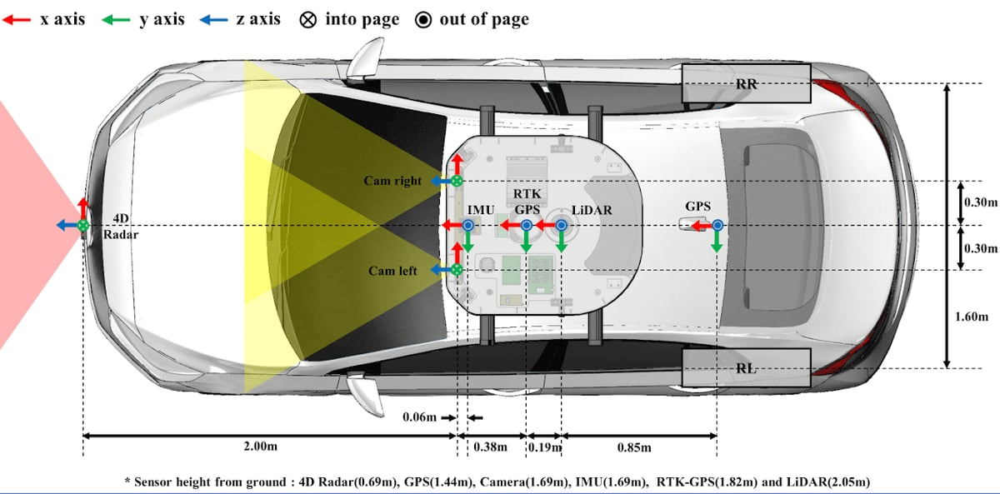
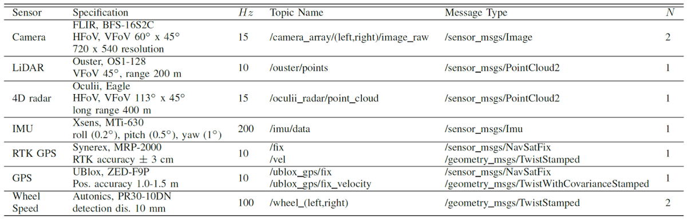
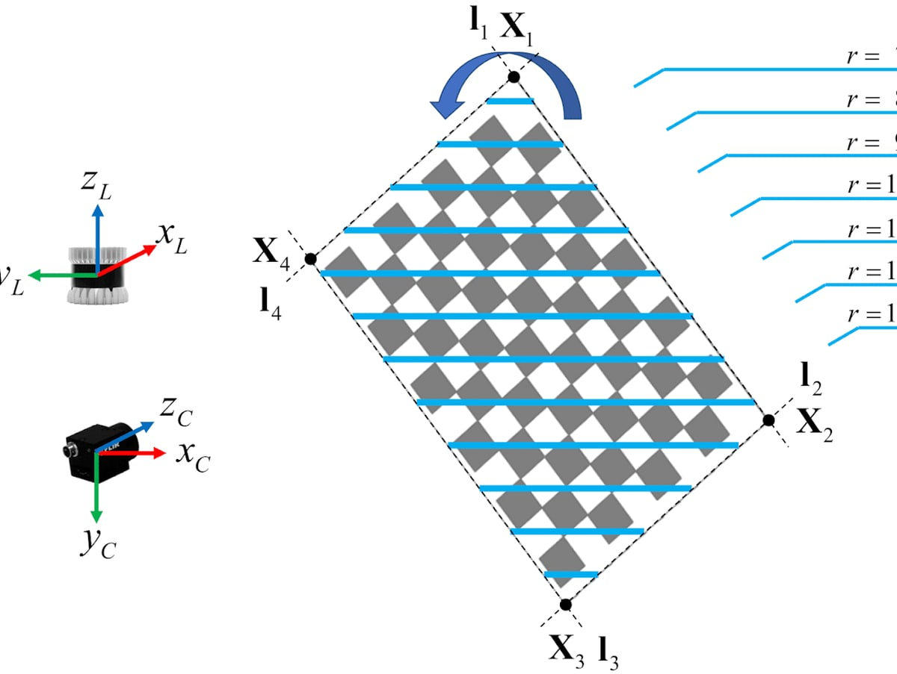
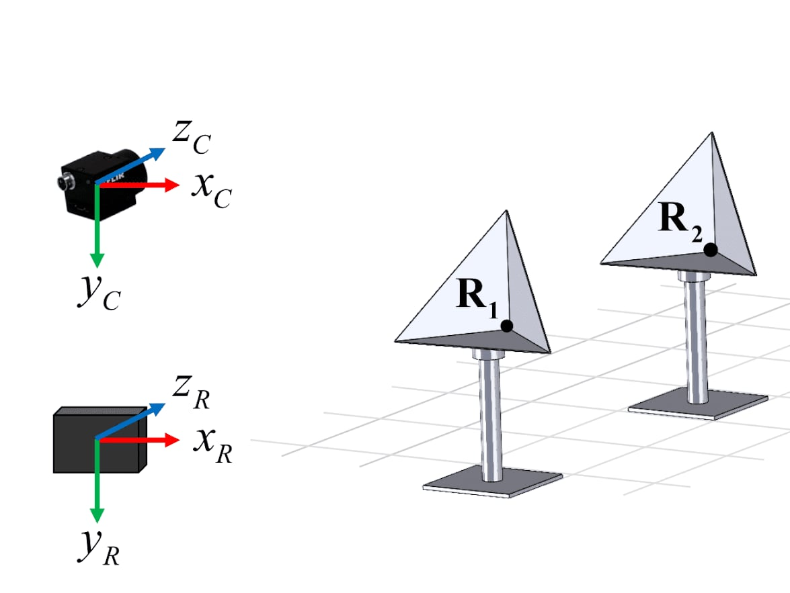

# 연구 분야

RV LAB은 경기대학교 전자공학부에서 자율주행과 휴머노이드 관련 기술을 연구합니다.

<!--
## 아이콘 분야 이름 (English Name) 하나가 연구 분야 하나입니다.
  유튜브 링크만 있는 줄 = 대표 영상, "키워드:" 줄 = 태그, 나머지 문단 = 소개
### 는 대표 연구:  유튜브 링크 줄 = 영상, > 인용 줄 = 논문 (앞에 "Under Review ·" 를 붙이면 심사 중 표시)
"Research Statement:" 로 시작하는 ## 절은 페이지 맨 아래 카드로 나옵니다.
  YouTube 주소만 있는 줄은 영상이 되고, 빈 줄 없이 이어 쓰면 나란히 배치됩니다. [제목](주소) 형식이면 제목이 붙습니다.
-->

## 🤖 휴머노이드 · Physical AI (Humanoids)

https://youtu.be/BRZAsonkIPI

IsaacSim 디지털 트윈 시뮬레이터를 기반으로 Vision Language Action(VLA), Imitation Learning, Vision Language Navigation(VLN) 같은 AI 기술을 접목해 실제 하드웨어에 적용합니다.

키워드: VLA, Imitation Learning, VLN, Sim2Real, IsaacSim Digital Twin, Biped Walking

### Biped Walking

https://youtu.be/RgJKCju_IRQ

공압 하이브리드 구동 기반의 저구속 이족 보행 로봇 PHAER

> Under Review · Donghyun Kim, Yun-Pyo Hong, Hyung-Tae Seo, Minseong Choi† and Kyung-Soo Kim†. "PHAER: Pneumatic Hybrid Actuated Efficient Robot With Under-Constrained Biped Walking", IEEE Transactions on Mechatronics, 2026.

### Physical AI

https://youtu.be/mruXADdMVBY

IsaacSim 기반 VR 원격조작으로 휴머노이드 ACT 정책을 학습하고 Jitter를 저감

> 김도윤, 강민수, 유강민, 서형태, 박영상†, 최민성†. "IsaacSim 기반 휴머노이드 ACT 학습제어를 위한 VR 원격조작 및 Jitter 저감 기법", 제어로봇시스템학회(ICROS), 2026.

### Imitation Learning

https://youtu.be/w7S2G6j_feM

센서리스 힘 추정과 비전 기반 제어 전환으로 로봇 정육 절단을 모방학습

> Under Review · Sangjun Yu*, Jungyu Kim*, Minjun Sung, Kyounghun Lee, Jeonghun Kim, Hyung-Tae Seo† and Minseong Choi†. "Vision-Based Control Switching with Sensorless Force Estimation for Robotic Meat Cutting via Imitation Learning", Sensors, 2026.

## 🚗 자율주행 인지 (Autonomous Driving)

https://youtu.be/ySjc261NPDk

Simultaneous Localization And Mapping(SLAM), Road Marking Segmentation, Camera-4D Radar 기반 Object Detection 같은 자율주행 인지 기술을 연구합니다.

키워드: Vector Map SLAM, 4D Radar, Sensor Fusion, Road Marking Segmentation, Vehicle Pose Estimation

### Vector Map SLAM

https://youtu.be/MEGpB7BKaMY

동적 객체 제거 마스크와 2단계 루프 검출을 이용한 4D Radar-Camera 벡터맵 SLAM

> Minseong Choi et al. "4D Radar-Camera Based Vector Map SLAM Using Dynamic Object Removal Mask with Two-Stage Loop Detection", IEEE Transactions on Instrumentation and Measurement, 2026.

### Semantic Segmentation

https://youtu.be/ytoQFS1PsT8

노이즈가 섞인 라벨에서도 강건한 불확실성 보호 증류 기반 노면표시 분할

> Under Review · Seunghoon Yang*, Minseong Choi*, Yeong Sang Park, Keun-Ha Choi and Kyung-Soo Kim. "UPRuNA: Uncertainty-Protected Distillation for Road Marking Segmentation under Noisy Annotations", IEEE Transactions on Intelligent Transportation Systems, 2026.

### Vehicle Pose Estimation

https://youtu.be/kQhd0cr3MuE

번호판 정보와 4D Radar 융합으로 단안 카메라 3D 차량 자세를 정밀화

> Under Review · Gangmin Yu, Chulju Park, and Minseong Choi†. "PLATER: License-Plate-Aided Monocular 3D Vehicle Pose Refinement with 4D Radar Fusion", IEEE Robotics and Automation Letters, 2026.

## Research Statement: 4D Radar-Camera 기반 Vector Map SLAM

[paper](https://drive.google.com/file/d/1M_D974EO7LoHFxPr-TdO2WLzaZert3wk/view) · [youtube](https://www.youtube.com/watch?v=MEGpB7BKaMY)

https://www.youtube.com/watch?v=MEGpB7BKaMY

벡터맵은 차선·노면표시 같은 도로 정보를 담은 HD map의 간소화된 표현으로, 전역 경로 계획과 차선 기반 위치추정에 필요합니다. 4D 이미징 레이더는 LiDAR보다 저렴하게 3D 깊이와 도플러 속도를 제공하고 악천후에도 강건해 카메라와 상호보완적입니다.

[Research Background](https://youtu.be/2y13MjR_Lzc)

1. **DORM 기반 Visual-4D Radar Odometry** — 4D 레이더 도플러 속도로 움직이는 특징점을 제거하는 Dynamic Object Removal Mask를 제안하고, 레이더 자차 속도 추정으로 단안 VO의 스케일 모호성을 해결
2. **소실점 보정 지면 기반 IPM 벡터 매핑** — 다중 경로 반사로 부정확한 레이더 지면 추정을 소실점 추적으로 보정해 실시간 3D 벡터맵 생성
3. **이중 확인 루프 검출** — 4D 레이더 Z projection image(coarse)와 벡터맵(fine)을 함께 사용한 루프 검출 및 포즈 그래프 최적화

[DORM 기반 Visual-4D Radar Odometry](https://youtu.be/rHpEkPfGP1E)
[소실점 보정 지면 기반 IPM 벡터 매핑](https://youtu.be/j00Kzy17pL0)
[이중 확인 루프 검출과 포즈 그래프 최적화](https://youtu.be/pjEDBYSI228)

### MSC-RAD4R 데이터셋과 센서 캘리브레이션

[paper](https://drive.google.com/file/d/1xDMapeXWkxFSfY63wUV0FMOuYrpjglGh/view) · [youtube](https://www.youtube.com/watch?v=ySjc261NPDk) · [dataset homepage](https://mscrad4r.github.io/home/)

4D Radar · 스테레오 카메라 · LiDAR · RTK-GPS · IMU를 갖춘 ROS 기반 자율주행 데이터셋으로, 주간·야간·눈·연기 등 다양한 환경에서 약 51.6km, 100분 분량을 수집했습니다.

https://www.youtube.com/watch?v=ySjc261NPDk

기울어진 체커보드로 고·저해상도 LiDAR 모두에 적용 가능한 LiDAR-카메라 캘리브레이션을, 연속된 삼각 반사판으로 4D Radar-카메라 캘리브레이션을 수행했습니다.

[Sensor Calibration](https://youtu.be/wpJO4A_zzeM)

#### 다양한 주행 환경

[Day Sample Data (URBAN_D0)](https://youtu.be/7Xb_l5jGBic)
[Night Sample Data (URBAN_D1)](https://youtu.be/i8RYn8NkT3c)
[Snow Sample Data (RURAL_E2)](https://youtu.be/XmZq_DF7Bo0)
[Smoke Sample Data (SMOKE_A0)](https://youtu.be/llEL8SdIteA)
